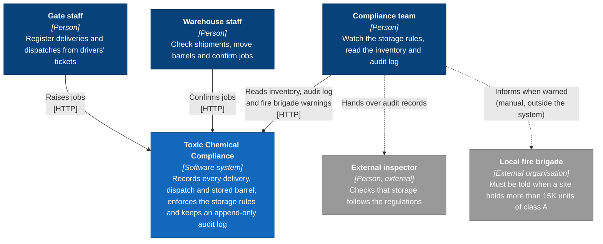
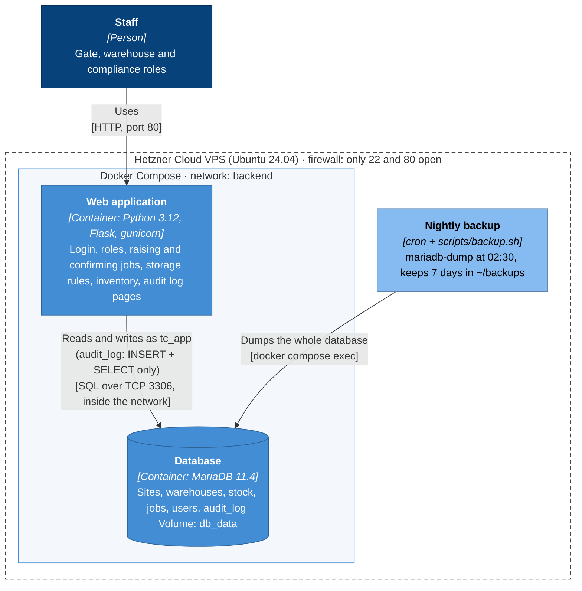
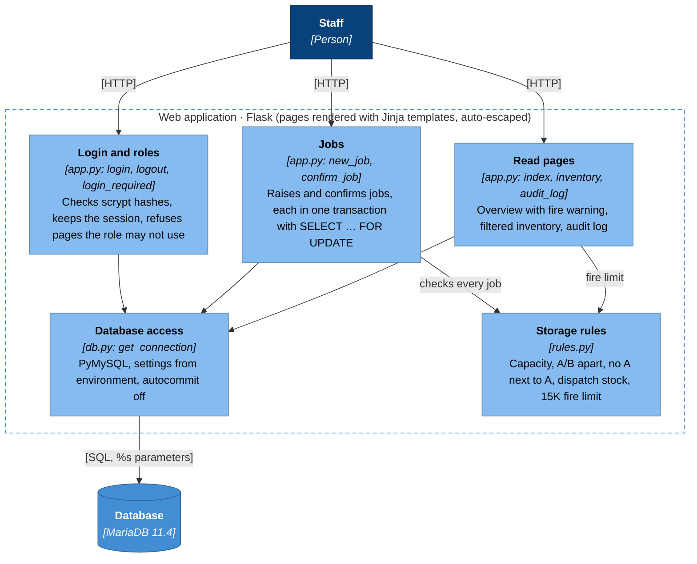

# Architecture (C4 model)

Three levels of the [C4 model](https://c4model.com), from the big picture down to the code. The diagrams are Mermaid, so GitHub draws them from the `.mmd` files below; the PNG files are the same diagrams for the report.

## Level 1: System context

Who uses the system and what it connects to. Informing the fire brigade and handing records to an inspector happen outside the system: the system gives the warning and the data, people act on them.

Image: [`c4-1-context.png`](c4-1-context.png) · source: [`c4-1-context.mmd`](c4-1-context.mmd)

## Level 2: Containers

What runs where in production. Two Docker containers on one Hetzner VPS; the database is only reachable inside the Docker network, and the app uses the limited `tc_app` account. The backup runs from cron on the server itself.

Image: [`c4-2-container.png`](c4-2-container.png) · source: [`c4-2-container.mmd`](c4-2-container.mmd)

## Level 3: Components of the web application

How the Flask app is split up. The storage rules live in `rules.py` with no database code, so they can be unit tested on their own (`app/tests/test_rules.py`).

Image: [`c4-3-component.png`](c4-3-component.png) · source: [`c4-3-component.mmd`](c4-3-component.mmd)
